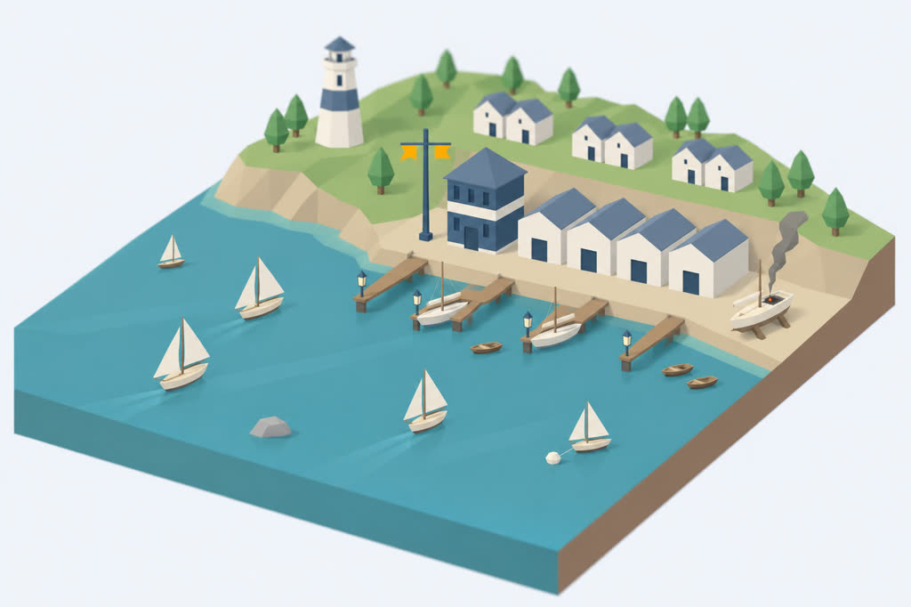
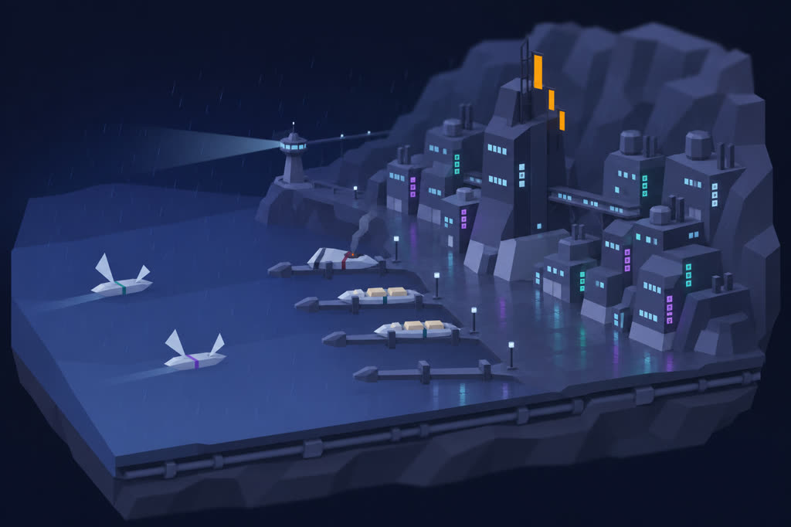

# Bridge low-poly reference

**Reference · not adopted.** Low-poly (style S2) was one of the two styles the
Style Study kept for Bridge's live diorama. On 2026-11-22 the operator chose
voxel as the art target and kept low-poly as a reference
([DDR-0018](../../../decisions/0018-bridge-art-target-voxel.md)):

> "I really like both and want to keep the references to both but I'm going to land on voxel by astra"

Cite it for comparison with the target,
[`pxo:art/bridge-voxel`](../bridge-voxel/README.md). It is not guidance, and
Bridge art is not reviewed against it.

## Rules

None. This is a reference, not a target. What the Style Study noted: clean and
calm, very close to voxel, the cheapest full 3D of the styles tried, and the
water must stay as a few big planes.

## Specimens

Two web-size stills, the same two scenes as the voxel target and framed the
same way.

| Scene | Still |
| --- | --- |
| The harbour, clear day (S2-H) |  |
| Low Vesper, night with rain (S2-V) |  |

## Sources

- The operator's decision, 2026-11-22:
  [DDR-0018](../../../decisions/0018-bridge-art-target-voxel.md).
- The Bridge Style Study, style S2, scenes S2-H and S2-V, rendered by
  GPT-6.2-Astra on 2026-11-21. The prompts and full-size renders are held in the
  coordinator's task data.
- IP: PixelOven's own invented scenes, generated for this review from
  PixelOven's prompts. The stills are kept small, as specimens.
