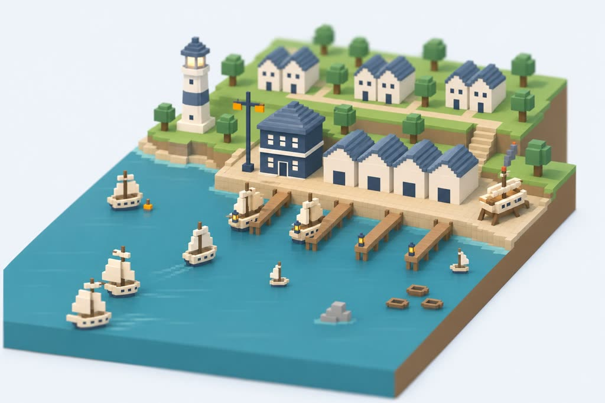
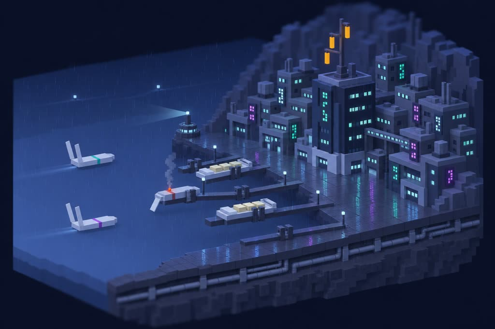

# Bridge art target, voxel (Astra rendition)

**Adopted · decided 2026-11-22 ([DDR-0018](../../../decisions/0018-bridge-art-target-voxel.md)).**
The art target for Bridge's live diorama is voxel (style S1), as rendered by
GPT-6.2-Astra. This entry records the target and its two reference stills. It
is **not an art bible**: an art bible enters the catalogue only once the
operator approves one ([DDR-0011](../../../decisions/0011-promote-on-evidence.md)).

The low-poly style (S2) is kept beside it as a reference, not adopted:
[`pxo:art/bridge-low-poly`](../bridge-low-poly/README.md). The same two scenes
were also rendered in voxel by GPT-6.2-Sol; that was the alternative seen, not
the target.

## Rules

- **The look is the Astra voxel stills below.** Chunky, clean cubes; one flat
  colour per material; a tilt-shift miniature diorama on a single slab, seen
  from a high three-quarter view; few elements, each easy to read; calm, empty
  space around the action.
- **The diorama grows and stays readable.** Every diorama has a procedural
  component, or some other method, so the scene grows and stays readable
  across:
  - **size:** from a few agents to 30 or more;
  - **variety:** several distinct orchestrators side by side;
  - **hierarchy:** the first mate, second mates and their workers.

  How this is met is not yet decided; the art bible must show it.

## Specimens

Two web-size stills, the same two scenes as the low-poly reference and framed
the same way.

| Scene | Still |
| --- | --- |
| The harbour, clear day (prompt P1) |  |
| Low Vesper, night with rain (prompt P4) |  |

## Accessibility

The scene sits behind work panels and never carries text. The live scene
rules, still proposed, are in
[`pxo:a11y/behaviours`](../../a11y/behaviours.md#live-scene-profile).

## Reference implementation

None yet. The stills are generated references, not production assets.

## Sources

- The operator's decision, 2026-11-22:
  [DDR-0018](../../../decisions/0018-bridge-art-target-voxel.md).
- The Bridge art reference prompts P1 and P4, rendered by GPT-6.2-Astra on
  2026-11-21. The prompts and full-size renders are held in the coordinator's
  task data.
- IP: PixelOven's own invented scenes, generated for this review from
  PixelOven's prompts, which exclude franchise ships, figures, symbols and
  lettering. The stills are kept small, as specimens.
